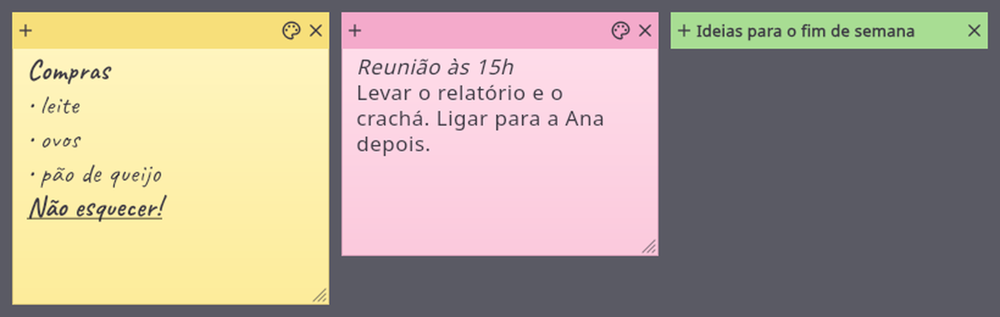

# Psito Notes

Sticky notes for the desktop, with cockatiels, for Windows and Linux, built with
Flutter. No ads, no telemetry and no account: just your notes, where you can see them.

In the spirit of the Sticky Notes of Windows 7 and the Stickies of the Mac: every note
is a little window of its own, which stays where you left it.



**[Website](https://francisceioseph.github.io/psito-notes/)**

## Features

- Six papers (yellow, blue, green, pink, purple and white), a handwritten and a plain font, and four text sizes
- Every note is a window of its own: the **+** makes a new one beside it, and the **×** throws it away
- Bold, italic, underline, strikethrough and lists, from the settings or with the shortcuts of the classic sticky notes
- A double click on the strip folds the note to its first line, like a window shade
- Keep a note above the other windows, or make it translucent
- Saved as you type, one file per note; the notes come back the next time you open the program
- Undo and redo that bring the formatting back too, and a question before a note with text goes away
- Keyboard shortcuts: `Ctrl+N` new note, `Ctrl+D` delete, `Ctrl+B`, `Ctrl+I`, `Ctrl+U` and `Ctrl+T` marks,
  `Ctrl+Shift+L` list, `Ctrl+Shift+>` and `Ctrl+Shift+<` text size, `Ctrl+Z` and `Ctrl+Y` undo and redo
- English, Portuguese, Spanish, French, German, Russian and Chinese

## Install

### On Windows

Windows 10 version 1809 or newer, or Windows 11, on x64. Download
[the installer](https://github.com/francisceioseph/psito-notes/releases/latest/download/psito-notes-windows-x64-setup.exe)
and run it. It doesn't ask for administrator rights.

The installer isn't signed with a paid certificate, so SmartScreen may warn that it
comes from an unknown publisher: choose **More info**, then **Run anyway**. New
versions are installed the same way, over the old one.

### From the APT repository

On Debian 13 or newer, Ubuntu 24.04 or newer, or Mint 22 or newer. It updates along with the system:

```bash
sudo mkdir -p /etc/apt/keyrings
curl -fsSL https://francisceioseph.github.io/psito-notes/psito-notes.asc | sudo tee /etc/apt/keyrings/psito-notes.asc >/dev/null
printf 'Types: deb\nURIs: https://francisceioseph.github.io/psito-notes\nSuites: stable\nComponents: main\nArchitectures: amd64\nSigned-By: /etc/apt/keyrings/psito-notes.asc\n' | sudo tee /etc/apt/sources.list.d/psito-notes.sources >/dev/null
sudo apt update
sudo apt install psito-notes
```

### From the DNF repository

On Fedora, on x86_64. It updates along with the system, and the first install asks you to accept the signing key:

```bash
sudo curl -fsSL -o /etc/yum.repos.d/psito-notes.repo https://francisceioseph.github.io/psito-notes/psito-notes.repo
sudo dnf install psito-notes
```

### From the source

You need Flutter 3.47 and the system libraries. On Debian, Ubuntu or Mint:

```bash
sudo apt install libgtk-3-dev ninja-build cmake clang pkg-config
```

Then build a package that installs for everyone, and needs no Flutter to run:

```bash
tool/build-deb.sh
sudo apt install ./build/deb/psito-notes_*_amd64.deb
```

## Develop

```bash
flutter run -d linux
flutter analyze
flutter test
```

The notes live in `lib/src/notes/`: the text with its marks (`styled_text.dart`), the
store, one JSON file per note, and the choice of the note each process opens. The window
is in `lib/src/platform/`, and the screens in `lib/src/ui/`, in atomic design. Texts live
in the `.arb` files in `lib/l10n/`, in seven languages.

To try it without touching your own notes, give it another data folder:

```bash
XDG_DATA_HOME=/tmp/notes-try flutter run -d linux
```

## Psito Games

Psito Notes is part of Psito Games, a suite of casual games and little programs made
in the spirit of the ones that came with Windows 7, alongside
[Psito Cell](https://github.com/francisceioseph/psito-cell),
[Psito Spider](https://github.com/francisceioseph/psito-spider),
[Psito Plume](https://github.com/francisceioseph/psito-plume),
[Psito Solitaire](https://github.com/francisceioseph/psito-solitaire),
[Psito Mines](https://github.com/francisceioseph/psito-mines) and
[Psito Nest](https://github.com/francisceioseph/psito-nest).

## License

The code is under the [Apache License 2.0](LICENSE) and the icon under
[CC0](assets/LICENSE.md). See [the third-party licenses](THIRD_PARTY_LICENSES.md).
